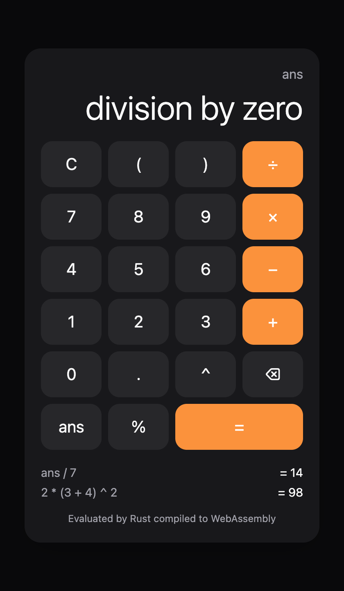

# Research log: Bazel monorepo with a Rust core and native front ends

Goal: a single Bazel workspace where a Rust core is consumed by a web app,
a macOS app, an iOS app and an Android app, all built by Bazel. The calculator
is only a vehicle; the point is to learn how the build graph fits together.

Entries are chronological. "Finding" = something learned that would matter
to anyone repeating this.

---

## 0. Environment (2026-10-23)

| Tool | Version |
| --- | --- |
| macOS | 27.0.1, arm64 |
| Xcode | 27.0 |
| Bazel | 9.3.1 (via Homebrew bazelisk 1.27, pinned in `.bazelversion`) |
| Host cargo/rustc | Homebrew; **not used by the build**, Bazel downloads its own |

Bazel Central Registry (BCR) versions at the start:

| Module | Version | Purpose |
| --- | --- | --- |
| rules_rust | 0.74.0 | Rust toolchains, `rust_library` etc., crate_universe |
| rules_rust_wasm_bindgen | 0.74.0 | `rust_wasm_bindgen` (separate BCR module) |
| rules_apple | 5.3.1 | `macos_application`, `ios_application` |
| rules_swift | 4.2.2 | `swift_library` |
| apple_support | 2.10.1 | Apple CC toolchain + Apple platforms |
| aspect_rules_js | 3.5.2 | npm/pnpm and JS tooling |
| rules_android | 0.8.0 | Android (future) |
| rules_kotlin | 2.4.21 | Kotlin (future) |

**Finding: Bazel 9 is bzlmod-only.** `WORKSPACE` is gone, so every dependency
goes in `MODULE.bazel`. Bazel 9 also finished moving native rules into
Starlark: `cc_library`, `objc_library` and the rest must be `load()`ed from
`@rules_cc`, and `sh_*` rules from `@rules_shell`. Many older blog posts and
examples are WORKSPACE-era and do not apply directly.

## 1. Research: architecture

### How a Rust crate reaches each platform

| Front end | Mechanism | Rust artifact | Binding generator |
| --- | --- | --- | --- |
| Web | WebAssembly | `rust_shared_library` built for `wasm32-unknown-unknown` | `wasm-bindgen` (`rust_wasm_bindgen` rule) |
| macOS / iOS | C ABI, linked statically into the app | static lib (`rust_library` provides `CcInfo`) | UniFFI to Swift, plus a C header and modulemap |
| Android | JNI / JNA, `.so` per ABI | `rust_shared_library` (cdylib) | UniFFI to Kotlin |

Chosen layering:

```
core/calc_core       pure Rust logic, no FFI annotations, unit-tested
bindings/uniffi      thin crate: #[uniffi::export] wrappers over calc_core  (Swift, Kotlin)
bindings/wasm        thin crate: #[wasm_bindgen] wrappers over calc_core     (JS)
tools/uniffi         uniffi-bindgen built from source as a rust_binary
apps/macos           SwiftUI, macos_application
apps/web             static page + wasm-bindgen JS
```

Why separate binding crates instead of sprinkling `#[uniffi::export]` and
`#[wasm_bindgen]` across the core: UniFFI does not target the browser (only
experimental wasm via external projects), and wasm-bindgen does not target
Swift or Kotlin. Keeping the core free of either keeps it testable with plain
`rust_test` and lets each binding layer pick its own types.

### Findings from reading rules_rust sources (0.74.0)

- **`rust_library` provides `CcInfo`.** It can be a direct dependency of
  `cc_library`, `objc_library` or `swift_library`, and the Apple linker step
  links the rlib plus Rust std. You do not need `rust_static_library` unless
  you want a standalone `.a` (for example, to feed a tool). See
  `examples/ios` in the rules_rust repo.
- **Cross-compiling needs `extra_target_triples`.** Each target triple you
  build for must be listed in `rust.toolchain(...)`. rules_apple's platform
  transitions (for example to `ios_sim_arm64`) then select the matching Rust
  toolchain by constraint.
- **wasm-bindgen version lock-step.** The `wasm-bindgen` crate your code links
  must be *exactly* the version of the `wasm-bindgen` CLI that post-processes
  the `.wasm`. `rules_rust_wasm_bindgen` 0.74.0 ships both, pinned to
  0.2.121, and exposes the crate as
  `@rules_rust_wasm_bindgen//3rdparty:wasm_bindgen`. Use that label instead of
  pulling wasm-bindgen from your own crate_universe; otherwise you will hit
  the "schema version mismatch" error.
- **`rust_wasm_bindgen` applies its own transition.** It switches
  `--platforms` to `@rules_rust//rust/platform:wasm` (via `target_arch`), so
  you never pass `--platforms` on the command line for the web build.
  `--target` (`web`, `bundler` and so on) is a rule attribute.
- crate_universe supports `crate.spec()` + `crate.from_specs()` in
  `MODULE.bazel`, with no `Cargo.toml` at all. Several independent repos can
  coexist (`from_specs(name = "...")` plus `spec(repositories = [...])`).

### Findings from reading UniFFI sources (0.32.2)

- UniFFI 0.32 has a **proc-macro-only** workflow (`uniffi::setup_scaffolding!()`
  plus `#[uniffi::export]`, no `.udl` and no `build.rs`). Bindings are
  generated in **library mode**: the bindgen reads `UNIFFI_META_*` symbols out
  of the compiled library.
- For Swift, library mode accepts a **static `.a`**. For other languages, the
  CLI requires a cdylib.
- **The bindgen shells out to `cargo metadata` by default.** That breaks in a
  Bazel sandbox, where there is no Cargo workspace. It is behind the
  `cargo-metadata` cargo feature (on by default). Building the bindgen with
  `default-features = false, features = ["cli"]` removes it entirely
  (`#[cfg(feature = "cargo-metadata")]` in `uniffi_bindgen/src/bindings/swift/mod.rs`).
- `uniffi::uniffi_bindgen_swift()` is a ready-made `main` for a Swift-only
  bindgen with `--swift-sources`, `--headers`, `--modulemap` and `--module-name`.
- **Metadata format is version-coupled.** The runtime `uniffi` crate linked
  into the library and the bindgen must be the same version. Pin `=0.32.2` in
  both specs.

## 2. Milestone: Rust core under Bazel

`bazel test //core/...` passes, with a cold build in about 30 s, mostly
downloading the toolchain.

- The Rust toolchain is pinned to 1.98.0 (the rules_rust 0.74 default) with
  edition 2024, set once in `rust.toolchain(edition = ...)` so no BUILD file
  repeats it.
- Observed linker warning:
  `clang: overriding '-mmacosx-version-min=11.0.0' option with '-target arm64-apple-macosx27.0'`.
  rustc passes deployment target 11.0, while Bazel's auto-configured host C
  toolchain targets the running OS. To revisit after registering
  apple_support's toolchain.

## 3. Milestone: web app (Rust to wasm to TypeScript), all in Bazel

```
bazel test //...                      # core tests, wasm binding test in Node, tsc typecheck
bazel run //apps/web:serve            # http://localhost:8080
bazel build --config=release //apps/web:site   # deployable directory
```



Build graph:

```
//core/calc_core (rust_library)
  └─ //bindings/wasm:calc_wasm (rust_shared_library, target_compatible_with wasm32)
       └─ :calc_wasm_bindgen (rust_wasm_bindgen, target="web")  ── transition to wasm32 platform
            └─ :calc_wasm_js (js_library: calc.js + calc.d.ts + calc_bg.wasm)
                 ├─ :calc_wasm_test (js_test: loads real wasm in Node)
                 └─ //apps/web:typecheck (ts_project, no_emit)  + :bundle (esbuild)
                      └─ :site (copy_to_directory) ─ :serve (js_binary)
```

Findings:

- **wasm-bindgen worked first time.** No `--platforms` flag is needed:
  `rust_wasm_bindgen`'s transition builds the `rust_shared_library` for
  wasm32. Adding `target_compatible_with = ["@platforms//cpu:wasm32"]` to the
  library means `bazel build //...` skips it in the host config instead of
  failing.
- **Cold cost: the wasm-bindgen CLI is compiled from source** (wasmparser,
  walrus and so on), about 100 s once and cached after that. A remote cache
  would hide this.
- **wasm size: 241 KB fastbuild, 105 KB `-c opt`.** Added
  `build:release --compilation_mode=opt`. `wasm-opt` (binaryen) is not wired
  in; that is the next size win, and there is no BCR module for it, so it
  would be an `http_archive` of the binaryen release.
- `--target web` + `init({ module_or_path })` keeps the wasm out of the JS
  bundle. esbuild bundles `calc.js` into `main.js`, while `copy_to_directory`
  places `calc_bg.wasm` beside it. The app passes an explicit URL, so the
  bundler never has to understand `new URL(..., import.meta.url)`.
- The dev server must send `Content-Type: application/wasm`, or
  `WebAssembly.instantiateStreaming` rejects the file. wasm-bindgen falls
  back to a slower path with a console warning. `tools/serve/serve.mjs` is a
  zero-dependency Node server run by `js_binary` on the hermetic Node
  toolchain. Because it serves the runfiles tree, a `bazel build` updates it
  live with no restart.

rules_js / rules_ts gotchas, each of which cost one build cycle:

1. **pnpm lifecycle allowlist is mandatory.** rules_js 3 fails unless
   `onlyBuiltDependencies` (pnpm < 10.26) or `allowBuilds` (pnpm >= 10.26) is
   set in `pnpm-workspace.yaml`, even if empty. Pass the workspace file in
   `npm_translate_lock(data = [...])`.
2. **Sources must live in the consuming package.** rules_js and rules_ts copy
   sources into `bazel-bin` per package. A `tsconfig.json` or `.mjs` from
   another package fails with "Expected to find file X in //a, but instead it
   is in //b". The fix is to keep the tsconfig next to its `ts_project`, and
   to share JS across packages only through `js_library`.
3. **rules_ts validates attrs against the tsconfig.** `no_emit = True` on the
   rule requires `"noEmit": true` in the JSON, and the same applies to
   `declaration` and similar options.
4. `aspect_bazel_lib` was renamed to **`bazel_lib`** (3.x), so
   `copy_to_directory` is at `@bazel_lib//lib:copy_to_directory.bzl`.
5. Generated wasm-bindgen outputs live in `bazel-bin`. TypeScript imports them
   by relative path (`../../../bindings/wasm/calc_wasm_bindgen/calc.js`)
   because rules_ts and esbuild run with the bin directory as the root, where
   sources and generated files are merged. That is the main mental-model
   shift from a normal JS repo.

Verified in headless Chrome (driven over the DevTools protocol):
`2 * (3 + 4) ^ 2` gives 98, then `ans / 7` gives 14, with history rendered,
and `1/0` surfaces Rust's `DivisionByZero` as a JS exception message.

## 4. Milestone: UniFFI Swift bindings generated and tested in Bazel

```
bazel test //bindings/uniffi:CalcFFITests   # XCTest: Swift -> generated bindings -> Rust
```

Build graph:

```
@tool_crates//:uniffi (features=["cli"], no default features)
  └─ //tools/uniffi:uniffi_bindgen_swift (rust_binary, exec cfg)
//bindings/uniffi:calc_ffi (rust_library, #[uniffi::export])
  ├─ :calc_ffi_swift_gen (genrule; rlib + bindgen in `tools` → exec cfg)
  │     → calc_ffi.swift, calc_ffiFFI.h
  ├─ :calc_ffiFFI (cc_library: header + deps=[calc_ffi]; swift_interop_hint module_name)
  └─ :CalcFFI (swift_library: generated .swift; `import CalcFFI` in app code)
```

Findings, in the order they bit:

1. **UniFFI proc-macros read `Cargo.toml` at compile time.** On stable Rust,
   `uniffi_macros` learns the crate's module path by parsing `[package].name`
   from `$CARGO_MANIFEST_DIR/Cargo.toml`. With nightly it uses
   `TokenStream::expand_expr` instead. rules_rust sets `CARGO_MANIFEST_DIR` to
   the Bazel package but there is no manifest there, so compilation fails
   with `failed to open file .../Cargo.toml`. **Fix:** a 2-line stub
   `Cargo.toml` (`[package] name = "calc_ffi"`) in `compile_data`. The name
   must equal the `rust_library` crate name.
2. **Library mode works on the `.rlib`.** No `rust_static_library` or cdylib
   is needed for Swift generation: `uniffi-bindgen-swift` finds the
   `UNIFFI_META_*` symbols inside the rlib's object files.
3. **Generate the bindings in the exec configuration.** Listing the rlib in
   the genrule's `tools` (not `srcs`) builds it for the host. The Swift/C
   output is target-independent, so one generation serves macOS, iOS device
   and iOS simulator, and you avoid cross-platform tool problems such as
   reading an iOS-arch library on the host.
4. **Allocator shim link error.** When Swift/clang (not rustc) does the final
   link, you get `Undefined symbols: __rustc..___rust_alloc_zeroed,
   ___rust_no_alloc_shim_is_unstable_v2...`. rustc only emits the allocator
   shim when it links the final artifact. **Fix:** in `.bazelrc`,
   `--@rules_rust//rust/settings:experimental_use_allocator_libraries_with_mangled_symbols=True`,
   which makes rules_rust supply the shim as a library. The same flag appears
   in rules_rust's own `examples/ios/.bazelrc`. This will matter for Android
   too, where the NDK linker links Rust.
5. **rules_swift 4 dropped the `tags = ["swift_module=..."]` convention.** To
   give a `cc_library` a specific Clang module name (the generated Swift does
   `#if canImport(calc_ffiFFI) import calc_ffiFFI`), use
   `swift_interop_hint(module_name = "calc_ffiFFI")` attached through
   `aspect_hints`. The generated `.modulemap` is not needed; rules_swift
   synthesizes one.
6. **`swift_test` fails at runtime on this machine:**
   `dyld: Library not loaded: @rpath/libXCTestSwiftSupport.dylib`. rules_swift
   hardcodes test rpaths to xcode-select's symlinks
   (`/private/var/select/developer_dir`, `/var/db/xcode_select_link`; see
   `_DEVELOPER_DIR_SYMLINKS` in `xcode_swift_toolchain.bzl`). Neither exists
   until someone runs `sudo xcode-select -s ...`. **Workaround:**
   `macos_unit_test` from rules_apple, which runs the `.xctest` bundle through
   `xcrun xctest` and works on a stock machine. (Running
   `sudo xcode-select -s /Applications/Xcode.app` would probably also fix
   `swift_test`. That is a CI-image gotcha worth remembering.)
7. **Two crate_universe repos.** `@crates` (runtime, linked into apps) and
   `@tool_crates` (the bindgen CLI with clap, askama, goblin and so on) both
   pin `uniffi = "=0.32.2"` with `default_features = False`. Keeping them
   separate stops Cargo feature unification from linking the CLI's
   dependency tree into the shipping library.

Aside: on first use, the `aspect_*` rulesets print a notice that they collect
anonymous ruleset-usage telemetry. Opt out with
`common --repo_env=DO_NOT_TRACK=1` in `.bazelrc`. I left it as the default;
it is your call.

## 5. Milestone: macOS SwiftUI app on the Rust core

```
bazel run //apps/macos:CalculatorMac                     # builds the .app and launches it
bazel test //apps/apple/CalculatorUI:CalculatorUITests   # model test + offscreen snapshot
```


Layout:

```
//apps/apple/CalculatorUI   swift_library: SwiftUI CalculatorView + @Observable model (shared with iOS later)
//apps/macos                swift_library (@main App) + macos_application
```

Findings:

- **The app itself built on the first try** once the bindings worked. The
  Rust code reaches the final link transitively through
  `swift_library → cc_library → rust_library (CcInfo)`, so app targets never
  mention Rust. The result is a 2.5 MB (fastbuild) thin arm64 `.app`,
  ad-hoc signed by rules_apple. `otool -L` shows no Rust dylib; the core is
  statically linked.
- rules_apple's transition produces a separate output config
  (`darwin_arm64-fastbuild-macos-arm64-min14.0-ST-<hash>`), so the Rust core
  is compiled again for the app's platform and minimum OS. Expect one Rust
  build per distinct Apple platform/min-OS combination. That is correct, but
  it costs time.
- **Verifying a GUI without a screen.** The terminal had no Screen Recording
  permission, so `screencapture` could not grab the window. Instead,
  `CalculatorUITests` renders the real `CalculatorView` with SwiftUI's
  `ImageRenderer` and writes a PNG to `$TEST_UNDECLARED_OUTPUTS_DIR`, which
  ends up in `bazel-testlogs/.../test.outputs/`. This works headless in CI and
  doubles as a cheap snapshot test. The same test drives `CalculatorModel`
  (keypresses → Rust → display/history/error).
- `macos_unit_test` first-run time is about 30 s (xctest host startup plus
  SwiftUI). Later runs are cached.
- **Deployment-target mismatch, fixed.** Without a configured minimum, the
  apple_support toolchain targets the *running* OS (macOS 27) while rustc
  assumes 11.0, so every Rust link warned
  `overriding '-mmacosx-version-min=11.0.0' option with '-target arm64-apple-macosx27.0'`.
  The fix in `.bazelrc` is `--macos_minimum_os`, `--host_macos_minimum_os` and
  `--(host_)action_env=MACOSX_DEPLOYMENT_TARGET=14.0`. Set these on day one:
  changing `--action_env` invalidates every cached action.

## 6. Milestone (bonus): iOS app from the same SwiftUI module

```
bazel build //apps/ios:CalculatorIOS                    # simulator .ipa (default on Apple Silicon)
bazel build --config=ios_device //apps/ios:CalculatorIOS  # needs provisioning_profile
```

- **Built on the first try for the simulator.** `//apps/ios` is about 20
  lines: an `@main` App plus `ios_application`, reusing
  `//apps/apple/CalculatorUI`. rules_apple's transition switched the platform
  to `ios_sim_arm64`, and rules_rust picked the `aarch64-apple-ios-sim`
  toolchain from `extra_target_triples` with no further config. Verified:
  `LC_BUILD_VERSION platform 7` (iOS Simulator), `minos 17.0`, and 103
  `uniffi_calc_ffi_fn*` symbols linked in.
- **Device:** `ios_application` fails at *analysis* without
  `provisioning_profile` ("Building for device, but no provisioning_profile
  attribute was set"). The toolchain itself works:
  `bazel build //apps/apple/CalculatorUI --platforms=@apple_support//platforms:ios_arm64`
  compiles the Rust core and Swift for `aarch64-apple-ios`. Only signing
  remains, either a `.mobileprovision` checked in or fetched, or
  `local_provisioning_profile` from rules_apple.
- Not run: no iOS Simulator *runtime* is installed (`xcrun simctl list runtimes`
  is empty, and `xcodebuild -downloadPlatform iOS` is a multi-GB download).
  The same applies to `ios_unit_test`. The macOS snapshot test already
  covers the shared SwiftUI code.
- Cost note: each Apple platform (macOS, iOS sim, iOS device) is a separate
  configuration, so the Rust core plus uniffi are compiled once per
  platform. A remote cache matters more as platforms are added.

## 7. Milestone: Kotlin bindings proven on the host JVM (Android groundwork)

No Android SDK or NDK is installed on this machine (no `ANDROID_HOME`,
nothing in `~/Library/Android`). Installing several GB of SDK was out of
scope for this run. Instead I proved everything up to APK packaging:

```
bazel test //bindings/uniffi:CalcFfiKotlinTest   # Kotlin -> JNA -> Rust (host .dylib), 3 JUnit tests
```

```
//tools/uniffi:uniffi_bindgen (generic CLI)            → //bindings/uniffi:calc_ffi_kotlin_gen (calc_ffi.kt)
//bindings/uniffi:calc_ffi_kt (kt_jvm_library + JNA from rules_jvm_external)
//bindings/uniffi:calc_ffi_shared (rust_shared_library → libcalc_ffi.dylib)
//bindings/uniffi:CalcFfiKotlinTest (kt_jvm_test; finds the dylib via $(rootpath))
```

Findings:

- **Kotlin generation also works from the rlib.** The CLI docs say
  "cdylib", but library mode only needs the metadata symbols.
- **UniFFI 0.32 changed `--config`.** It now expects a *global* config with
  `[defaults]`, `[crates.<name>]` or `[crate-roots]`. An old flat
  `uniffi.toml` is ignored with only a warning, so the setting silently has no
  effect. With `cargo-metadata` disabled, a `uniffi.toml` next to the crate is
  never auto-discovered either. Pass `--config` explicitly, keyed by crate:
  `[crates.calc_ffi.bindings.kotlin]`.
- **Set `cdylib_name` explicitly.** The default is derived from the input
  file name, and rules_rust rlibs are hash-suffixed
  (`libcalc_ffi-1523509694.rlib`), so the generated loader asked JNA for
  `calc_ffi-1523509694`. `rust_shared_library` outputs are *not* hashed
  (`libcalc_ffi.dylib`).
- **Never name a UniFFI error field `message`.** Swift accepted it. Kotlin
  failed with "overload resolution ambiguity", because error variants become
  `Exception` subclasses and the field collides with `Throwable.message`.
  Renamed to `reason`. Lesson: compile the bindings for *every* language in
  CI, not just the one you are working on.
- The JVM test points UniFFI at the Bazel-built dylib through the
  generated hook `System.setProperty("uniffi.component.calc_ffi.libraryOverride", path)`,
  using a path from `env = {"CALC_FFI_LIB": "$(rootpath ...)"}`. The same hook
  is the cleanest fix for the Android `.so` naming problem below.

## 8. Research: what Android will take (not built)

Pieces and versions (BCR, today):

| Need | Module | Notes |
| --- | --- | --- |
| Android rules | `rules_android` 0.8.0 | Required for Bazel 9, which removed the native `android_*` rules. Reads the SDK from `ANDROID_HOME`. Toolchains: `register_toolchains("@androidsdk//:sdk-toolchain", "@androidsdk//:all")`. README: Bazel 7.7+, 8.5+ or 9+ (8.0–8.4.2 unsupported due to `flag_alias`). |
| NDK C toolchain | `rules_android_ndk` 0.1.5 | Reads a *local* NDK (r25b+) from `ANDROID_NDK_HOME`; it does not download one. `register_toolchains("@androidndk//:all")`. |
| Kotlin | `rules_kotlin` 2.4.21 | `kt_android_library`. Already in MODULE for the JVM test. |
| JNA | `rules_jvm_external` 7.2 | Use `net.java.dev.jna:jna:5.17.0@aar`, which bundles `libjnidispatch.so` per ABI. |
| Rust | `rules_rust` | Add `aarch64-linux-android`, `x86_64-linux-android` to `extra_target_triples` (crate_universe already lists them). rules_rust links with the NDK clang chosen by C toolchain resolution. |

The planned graph mirrors Apple:

```
android_binary(name = "calc_android", deps = [":app_lib"])        --android_platforms=//platforms:android_arm64,//platforms:android_x86_64
  └─ kt_android_library(":app_lib", srcs = MainActivity.kt, deps = [":calc_ffi_android_kt", "//bindings/uniffi:calc_ffi_ccdeps"])
       ├─ kt_android_library(":calc_ffi_android_kt", srcs = [kotlin gen with android = true], deps = ["@maven//:net_java_dev_jna_jna" (aar)])
       └─ cc_library(deps = ["//bindings/uniffi:calc_ffi"])  ← rust_library via CcInfo, same as Apple
```

Gotchas found in the sources, to verify when building:

1. **`android_binary` merges all native deps into one `.so`.** rules_android's
   `native_deps.bzl` links every `CcInfo` dependency into
   `lib<android_binary name>.so`, not `libcalc_ffi.so`. UniFFI's Kotlin
   loader asks JNA for `cdylib_name`. Two fixes: set `cdylib_name` to the
   `android_binary` name, or, preferably, keep one bindings artifact and call
   `System.setProperty("uniffi.component.calc_ffi.libraryOverride", "<binary name>")`
   in `Application.onCreate` before first use. The
   `disable_fallback_native_deps_linking` feature appears to switch merging
   off; untested.
2. **Generate a separate Kotlin variant for Android.** The Kotlin config has
   `android = true` (`android_cleaner`), which uses `android.system.SystemCleaner`.
   That class is absent on a desktop JVM, so produce two genrule outputs from
   two `[crates.calc_ffi.bindings.kotlin]` configs: JVM for tests and Android
   for the app.
3. The allocator-shim flag already in `.bazelrc` is required here too: the
   NDK linker, not rustc, links the rlibs.
4. With R8/minify, add keep rules for `com.sun.jna.**` and the generated
   package, because JNA binds by reflection.
5. Jetpack Compose under rules_kotlin needs the Compose compiler plugin wired
   as a `kt_compiler_plugin`. For a POC, classic Views avoid that entirely.
6. `--android_platforms` (not `--platforms`) drives the multi-ABI split. Define
   `platform()`s with `@platforms//os:android` plus a CPU.

Estimated effort once the SDK/NDK are installed is a few hours. The binding
layer, the hardest part, is already proven by `CalcFfiKotlinTest`.
