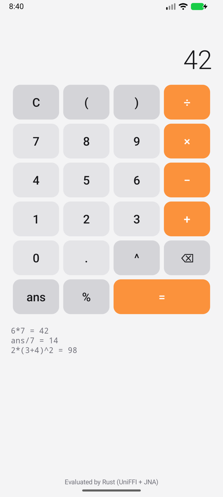

# rust-core-experiment

A Bazel 9 monorepo where one Rust core powers a web app, a macOS app, an iOS
app and an Android app. Everything is built and tested
by Bazel. All behaviour, including UI state, lives in Rust; each app only
draws the Rust view model. The calculator is just the vehicle. **See [LOG.md](LOG.md) for the
research log and every gotcha hit along the way.**

```
core/calc_core          Rust: expression evaluator + stateful Calculator (pure, no FFI)
core/calc_ui            Rust: UI view model (keypad, input, keyboard, errors, history)
                        keypad() is static and fetched once; the ViewModel is
                        only what changes between keystrokes
bindings/wasm           wasm-bindgen wrapper of calc_ui → JS/TS (web)
bindings/uniffi         UniFFI wrapper of calc_ui      → Swift (Apple) + Kotlin (Android/JVM)
tools/uniffi            uniffi-bindgen(-swift) built from source as rust_binary
apps/web                renderer: TypeScript + esbuild, served by a tiny Node server
apps/apple/CalculatorUI renderer: SwiftUI, shared by macOS and iOS
apps/macos, apps/ios    macos_application / ios_application
apps/android            renderer: Kotlin (plain Views) + android_binary; Rust ships as libcalc_ffi.so
```

| Command | What it does |
| --- | --- |
| `bazel test //...` | Rust unit tests, wasm-in-Node test, web renderer test (bundle + stub DOM), tsc typecheck, Swift XCTest (bindings + UI snapshot), Kotlin JUnit via JNA, dev-server test |
| `bazel run //apps/web:serve` | Web app on http://localhost:8080 |
| `bazel run //apps/macos:CalculatorMac` | Build and launch the macOS app |
| `bazel build //apps/ios:CalculatorIOS` | iOS simulator `.ipa` |
| `bazel build //apps/android:calc_android` | Android APK (arm64-v8a); `adb install -r bazel-bin/apps/android/calc_android.apk` |
| `bazel build --config=release //apps/web:site` | Optimized web bundle (~125 KB wasm; only `opt` minifies the JS) |

Requirements: bazelisk. Bazel downloads Rust, Node, the JDK and (on Linux)
a hermetic LLVM C/C++ toolchain, so a Linux box needs no compiler at all.
Bazel also downloads a pinned Android SDK and NDK (macOS and x86_64 Linux
hosts), so no Android Studio is needed. Apple targets need macOS with Xcode
and are skipped elsewhere. See LOG.md sections 13–15.

| Web | macOS (offscreen snapshot test) | Android (emulator) |
| --- | --- | --- |
|  |  |  |
