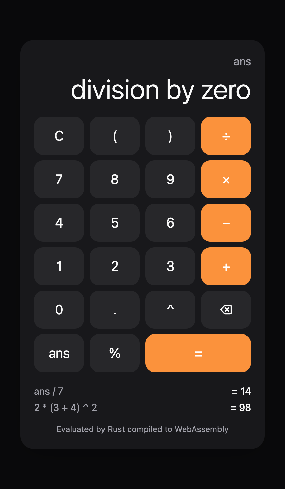
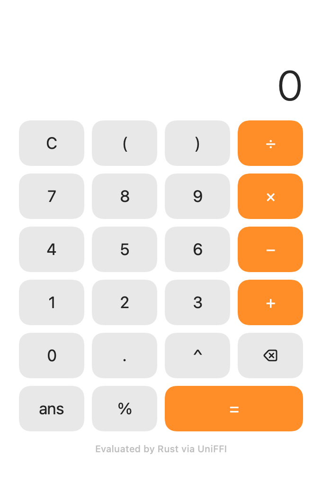
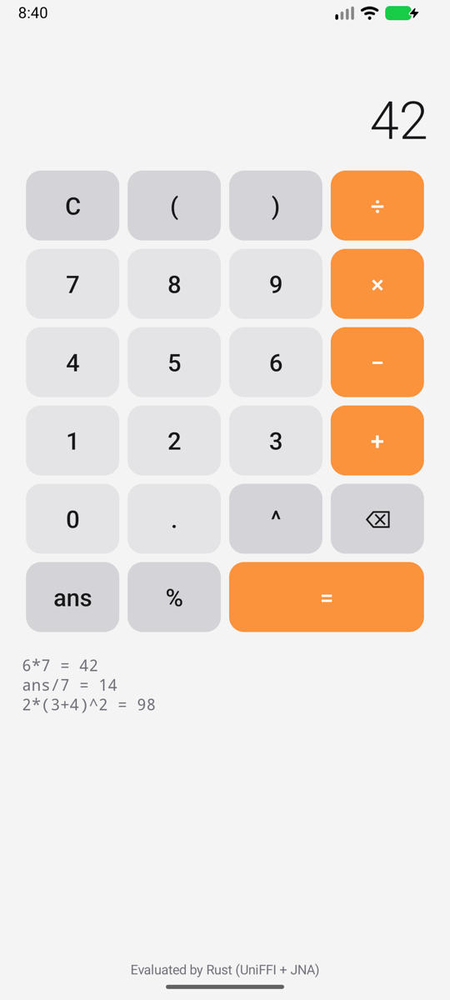

# rust-core-experiment

[](https://github.com/dmashuda/rust-core-experiment/actions/workflows/ci.yml)

A Bazel 9 monorepo where one Rust core powers a web app, a macOS app, an iOS
app and an Android app. Everything is built and tested
by Bazel. All behaviour, including UI state and persistence, lives in Rust;
each app only draws the Rust view model. History is kept in SQLite on every
platform: a file in the app sandbox natively, and in SQLite's own memory in
the browser. The calculator is just the vehicle. **See [LOG.md](LOG.md) for the research log
and every gotcha hit along the way.**

```
core/calc_core          Rust: expression evaluator + stateful Calculator (pure, no deps)
                        history goes through a HistoryStore trait
core/calc_ui            Rust: UI view model (keypad, input, keyboard, errors, history)
                        keypad() is static and fetched once; the ViewModel is
                        only what changes between keystrokes. Its types are
                        the ones the bindings hand out: the `wasm` feature
                        adds wasm-bindgen's attributes, UniFFI declares them
                        remote
core/calc_history_sqlite  Rust: the SQLite HistoryStore (rusqlite), the only
                        crate that knows SQLite exists
bindings/wasm           wasm-bindgen wrapper of calc_ui → JS/TS (web)
bindings/uniffi         UniFFI wrapper of calc_ui      → Swift (Apple) + Kotlin (Android/JVM)
tools/uniffi            uniffi-bindgen(-swift) built from source as rust_binary
tools/wasm_bindgen      wasm-bindgen CLI built from source, version-matched to
                        the crate (the ruleset's pinned pair is too old for
                        SQLite-in-wasm)
bazel/*.MODULE.bazel    the toolchains, one file per stack, include()d by MODULE.bazel
apps/web                renderer: TypeScript + esbuild, served by a tiny Node server
apps/apple/CalculatorUI renderer: SwiftUI, shared by macOS and iOS
apps/macos, apps/ios    macos_application / ios_application
apps/android            renderer: Kotlin (plain Views) + android_binary; Rust ships as libcalc_ffi.so
```

| Command | What it does |
| --- | --- |
| `bazel test //...` | Rust unit tests (evaluator, view model, SQLite store), wasm-in-Node test, web renderer test (bundle + stub DOM), tsc typecheck, Swift XCTest (bindings + UI snapshot), Kotlin JUnit via JNA, APK contents check (the Rust `.so` is inside), dev-server test |
| `bazel run //apps/web:serve` | Web app on http://localhost:8080 |
| `bazel run //apps/macos:CalculatorMac` | Build and launch the macOS app |
| `bazel build //apps/ios:CalculatorIOS` | iOS simulator `.ipa` |
| `bazel build --config=ios_device //apps/ios:CalculatorIOS` | iPhone `.ipa`, signed with your Xcode profile; see [Installing on an iPhone](#installing-on-an-iphone) |
| `bazel build //apps/android:calc_android` | Android APK (arm64-v8a); `adb install -r bazel-bin/apps/android/calc_android.apk`. Build that target on its own: `bazel build //...` repoints `bazel-bin` at a configuration the APK is not in |
| `bazel build --config=release //apps/web:site` | Optimized web bundle (~1.27 MB wasm, most of it SQLite; only `opt` minifies the JS) |

### Installing on an iPhone

A device build has to be signed. The build uses the provisioning profile Xcode
creates for the app's bundle id, `dev.mashuda.rustcalc`, so it needs a Mac with
Xcode and a free Apple Account; a paid developer account is not required.
These steps are done once per Mac and phone.

1. **Sign in to Xcode** with your Apple Account (the one you use for iCloud):
   Xcode → Settings → Accounts → **+** → Apple ID. Xcode creates a free
   "Personal Team" for it.
2. **Connect the iPhone** by USB, unlock it and tap **Trust** on the "Trust
   This Computer?" prompt.
3. **Turn on Developer Mode** on the phone: Settings → Privacy & Security →
   Developer Mode (at the bottom), then **Restart**. After the restart, unlock
   the phone and tap **Turn On**. The switch is hidden until the phone has been
   connected to a Mac with Xcode open.
4. **Create the signing certificate and profile.** In Xcode, make a new iOS App
   project with the bundle identifier `dev.mashuda.rustcalc`, choose your
   Personal Team under Signing & Capabilities ("Automatically manage signing"
   on), and run it on the phone once. This registers the phone with your team
   and creates the profile `iOS Team Provisioning Profile: dev.mashuda.rustcalc`,
   which `apps/ios/BUILD.bazel` looks up by name. You can delete the project
   afterwards.
5. **Build and install:**

   ```sh
   bazel build --config=ios_device //apps/ios:CalculatorIOS
   xcrun devicectl list devices      # the phone's identifier
   xcrun devicectl device install app --device <identifier> \
       bazel-bin/apps/ios/CalculatorIOS.ipa
   ```

6. **Trust the developer certificate** on the phone, once: Settings → General →
   VPN & Device Management → Apple Development: *your email* → **Trust**.
   Until then the app is installed but will not open.

With a free account the app stops opening after 7 days; build and install
again. If the profile has expired too, the build fails with "no provisioning
profile was found"; run the Xcode project from step 4 on the phone again.
If Xcode says `dev.mashuda.rustcalc` is not available to your team, choose
another bundle id and change both `bundle_id` and `profile_name` in
`apps/ios/BUILD.bazel` to match it.

### Checks

```sh
bazel test //...                                      # everything in the table above
bazel run @rules_rust//tools/rustfmt                  # apply .rustfmt.toml
bazel run @rules_rust//tools/rust_analyzer:gen_rust_project   # rust-project.json for IDEs

bazel build --aspects=@rules_rust//rust:defs.bzl%rust_clippy_aspect \
    --output_groups=clippy_checks //core/... //bindings/... //tools/...
bazel build --aspects=@rules_rust//rust:defs.bzl%rustfmt_aspect \
    --output_groups=rustfmt_checks //core/... //bindings/... //tools/...
```

CI (`.github/workflows/ci.yml`) runs all of those on Linux, which is also what
keeps the hermeticity claims below honest. The Apple tests are not covered
there: a second matrix leg does not fit in GitHub's 10 GB per-repository
cache budget, so they are left to `bazel test //...` on a Mac (see the comment
at the top of the workflow for how to re-enable them).

Requirements: bazelisk. Bazel downloads Rust, Node, the JDK and a hermetic
LLVM C/C++ toolchain -- which also supplies the clang that compiles SQLite's
C to wasm32 -- so a Linux box needs no compiler at all.
Bazel also downloads a pinned Android SDK and NDK (macOS and x86_64 Linux
hosts), so no Android Studio is needed. Apple targets need macOS with Xcode
and are skipped elsewhere. See LOG.md sections 13–15.

| Web | macOS (offscreen snapshot test) | Android (emulator) |
| --- | --- | --- |
|  |  |  |

## License

MIT, see [LICENSE](LICENSE).
